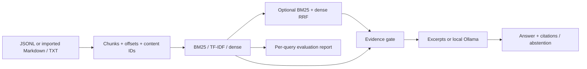

# PaperTrail

**Find ML papers. Inspect the evidence. Measure the retrieval.**

A Python research-search project with lexical baselines, optional neural retrieval,
source-traceable excerpts, a local LLM adapter, and reproducible evaluation.
Built as an ML Engineer / Data Scientist portfolio project.

**Status:** runnable v0.1. The bundled corpus is ten AI-assisted, original research
notes based on linked paper abstracts, **not the papers' full text**. The evaluation
is a small authored demonstration, not independent evidence of real-world quality.
Neural retrieval and live LLM generation require separate model downloads.

## Quick start

Python 3.11+; run commands from the repository root.

```bash
python -m venv .venv
source .venv/bin/activate
pip install -e '.[dev]'
papertrail search 'low rank adaptation frozen weights'
papertrail answer 'How does QLoRA reduce memory with quantization?'
uvicorn papertrail.api:app --host 127.0.0.1 --port 8000
```

Open [interactive API documentation](http://127.0.0.1:8000/docs).
`POST /search` and `POST /answer` accept `{"query": "low rank adaptation", "k": 3}`.
`GET /health` reports index size, retrieval method and corpus fingerprint.
The default answer mode returns exact research-note excerpts with source IDs;
it does not generate an explanation or claim to answer every question.

## Architecture



| Component | Decision |
|---|---|
| Lexical baselines | BM25 with k1=1.5, b=0.75; unigram TF-IDF cosine |
| Neural retrieval | Optional Sentence Transformers, normalized embeddings |
| Hybrid | Reciprocal rank fusion, constant 60, top 50 per branch |
| Chunking | 180 whitespace tokens, 30 overlap, exact source character offsets |
| Provenance | Paper ID, source URL/path, content-derived chunk ID, corpus SHA-256 |
| Answering | Exact excerpts by default; optional local Ollama |
| Evaluation | Document Recall/MRR/nDCG@k, abstention, retrieval p50/p95 |

Indexes are built once at API startup and held in memory. This deliberately simple
design is suitable for small collections; it is not a distributed vector database.
The default corpus and tokenizer are English; multilingual quality is not measured.

## Reproduce experiments

```bash
papertrail evaluate --method bm25 --output reports/bm25.json
papertrail evaluate --method tfidf --output reports/tfidf.json
pytest -q
ruff check .
```

See [experiment report](reports/RESULTS.md) and [evaluation protocol](docs/EVALUATION.md).
The reports include each query's ranked papers, labels, latency, package versions,
and hashes. Unsupported queries are excluded from ranking metrics and evaluated
separately for abstention. Different chunks from one paper count only once.

### Optional neural retrieval

```bash
pip install -e '.[semantic]'
papertrail evaluate --method dense --output reports/dense.json
papertrail evaluate --method hybrid --output reports/hybrid.json
PAPERTRAIL_METHOD=hybrid uvicorn papertrail.api:app
```

Default encoder: `sentence-transformers/all-MiniLM-L6-v2`. First use downloads
weights. The CLI accepts `--model` for another encoder. No neural performance
numbers are claimed until those experiments are actually run.

### Optional local generation

Install Ollama separately and pull a model compatible with your hardware, then:

```bash
papertrail answer 'How does LoRA adapt frozen models?' --ollama-model YOUR_LOCAL_MODEL
PAPERTRAIL_OLLAMA_MODEL=YOUR_LOCAL_MODEL uvicorn papertrail.api:app
```

The adapter uses Ollama's `/api/chat`. API host is configured with
`PAPERTRAIL_OLLAMA_URL` (default `http://localhost:11434`). Validating citation IDs
does **not** validate entailment or guarantee that every sentence has a citation.
The lexical evidence gate is an uncalibrated heuristic, can reject paraphrases,
and can accept irrelevant questions sharing keywords. Prompt instructions are
defense in depth, not a complete prompt-injection defense.

## Bring your own papers

Export text to Markdown/TXT, one paper per file, preserving section headings.
Direct PDF parsing, OCR and page-level citations are not implemented.

```bash
papertrail import ./my-papers --output data/private/papers.jsonl
papertrail search 'contrastive learning' --corpus data/private/papers.jsonl
PAPERTRAIL_CORPUS=data/private/papers.jsonl uvicorn papertrail.api:app
```

Alternatively supply JSONL records with string fields `id`, `title`, `source`,
`text`, and `kind`. Do not reuse the demo relevance judgments with a new corpus.
Imported local files remain local in default/extractive mode. Generation sends
retrieved excerpts to the configured Ollama host. No API authentication, rate
limits or multi-user isolation are included; bind locally for the demo.

## Docker

```bash
docker build -t papertrail .
docker run --rm -p 127.0.0.1:8000:8000 papertrail
```

## Making this a strong Middle-level case study

The working foundation is here; the central research contribution still needs
an independent evaluation. See [research roadmap](docs/ROADMAP.md) for acceptance
criteria: a larger licensed corpus, independently annotated questions, frozen
test set, neural ablations, error analysis and answer-grounding evaluation.
Do not present this demo's metrics as a production benchmark.

Code and original notes: MIT. Referenced papers retain their own licenses.
See [data card](data/README.md) for provenance and limitations.

Implementation references: [Sentence Transformers retrieval](https://www.sbert.net/examples/sentence_transformer/applications/semantic-search/README.html),
[FastAPI testing](https://fastapi.tiangolo.com/tutorial/testing/),
[Ollama chat API](https://docs.ollama.com/api/chat).
